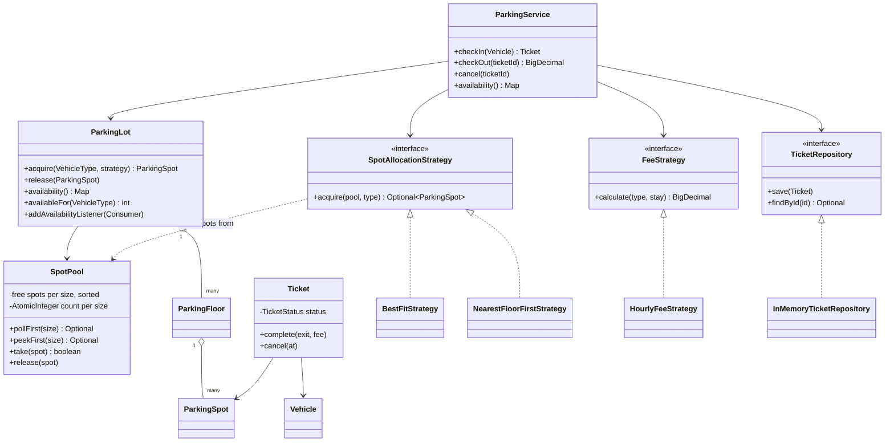
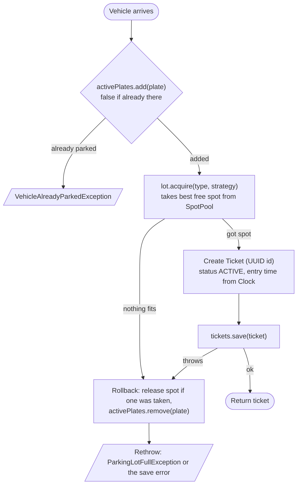
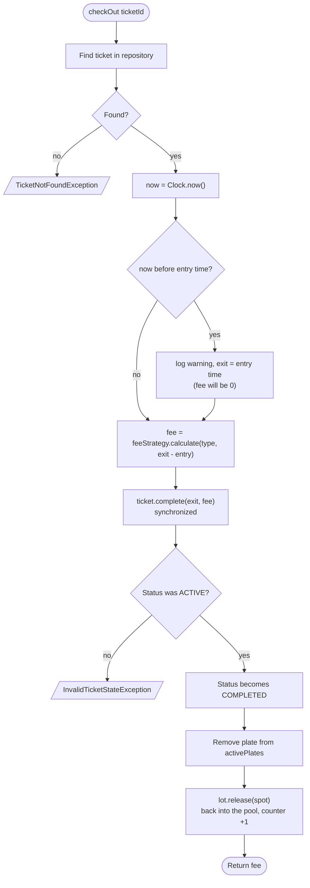
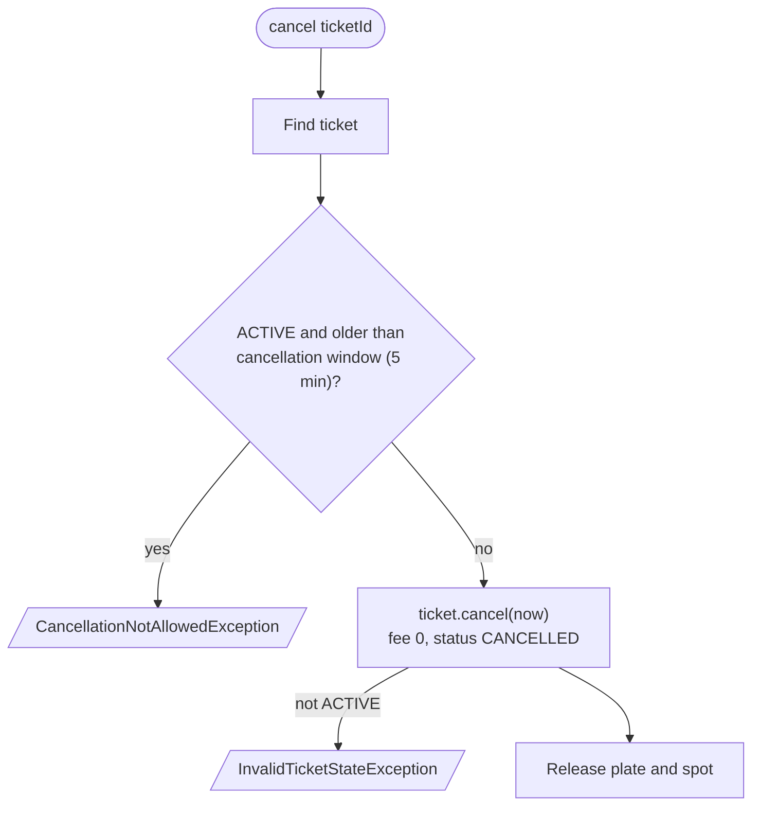
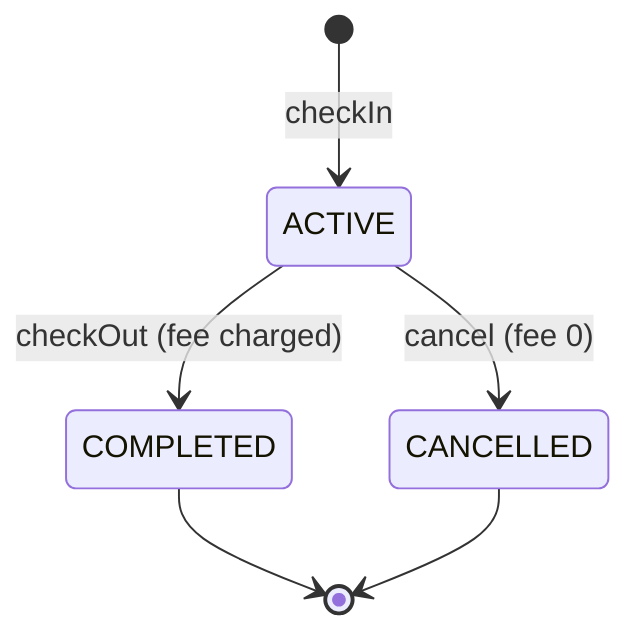
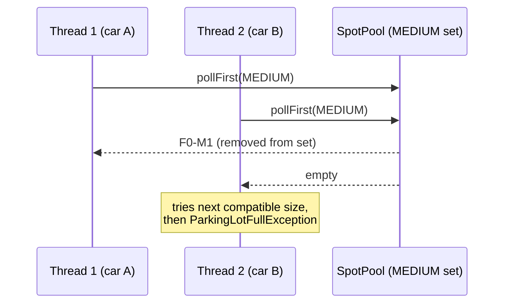
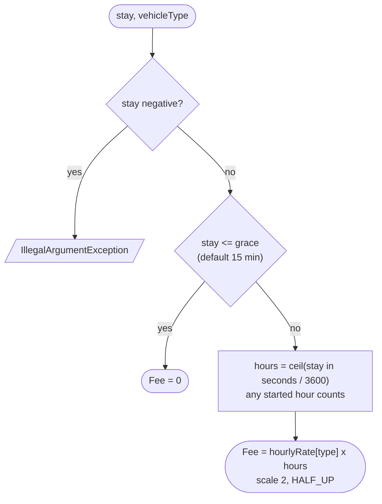
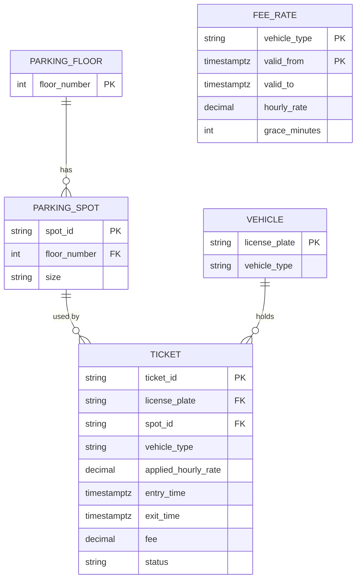

# Flows and diagrams

Mermaid diagrams for the parking lot. GitHub and IntelliJ (Markdown plugin) render them.

## 1. Class overview

## 2. Check-in

Because the rollback is in a `catch`, a failed entry (lot full, or a repository error) never leaks a spot or leaves the plate stuck as "parked".

## 3. Check-out

Only the caller that wins `ticket.complete()` reaches the release step, so a spot can't be released twice.

### Cancel

## 4. Ticket lifecycle

Any other transition throws `InvalidTicketStateException`.

## 5. Two cars racing for the last spot

`pollFirst` / `remove` on the concurrent set is atomic, so only one thread can get a given spot.

## 6. Fee calculation

Default rates per hour: motorcycle 10, car 20, bus 50.

| Stay (car) | Fee |
|---|---|
| 15 min | 0.00 |
| 15 min 1 s | 20.00 |
| 1 h | 20.00 |
| 1 h 1 s | 40.00 |

## 7. Spot allocation orders

`SpotPool` keeps free spots in one sorted set per size (lowest floor, then id). A strategy chooses which sets to take from.

| Strategy | How it picks | Why |
|---|---|---|
| `BestFitStrategy` | smallest compatible size that has a free spot, then lowest floor, then id | keeps large spots free for buses |
| `NearestFloorFirstStrategy` | looks at the head of each compatible size, takes the lowest floor (then size, then id), retries if someone else got it first | shortest walk to the exit |

Compatible sizes, best fit first: motorcycle `SMALL, MEDIUM, LARGE` (no `LARGE` if the lot is built with `motorcyclesMayUseLarge = false`), car `MEDIUM, LARGE`, bus `LARGE`.

## 8. Data model

Partial unique indexes on `ticket` allow only one `ACTIVE` ticket per plate and per spot. A spot has no `occupied` column: an `ACTIVE` ticket is what makes it taken. `ticket` also has checks for `exit_time >= entry_time` and for status/exit/fee consistency, and the rate used is copied onto the ticket. See `src/main/resources/schema.sql`.
