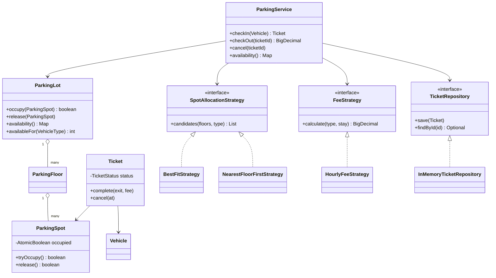
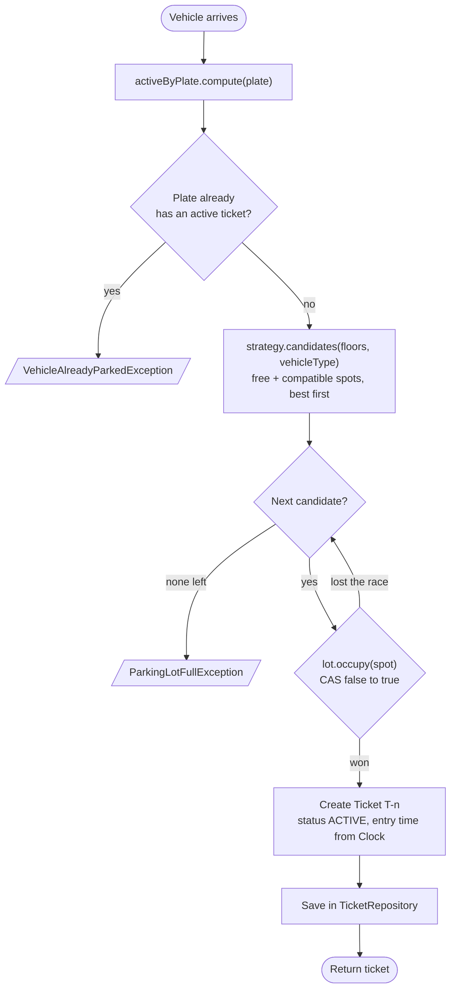
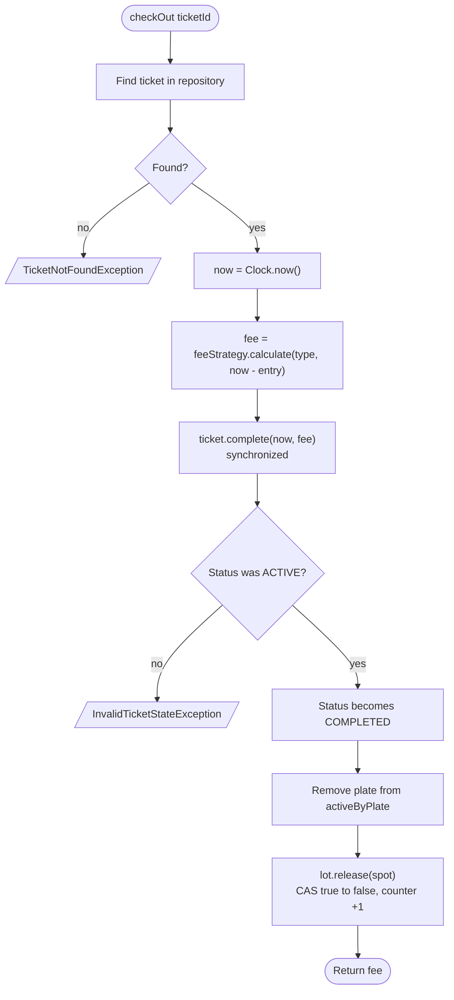
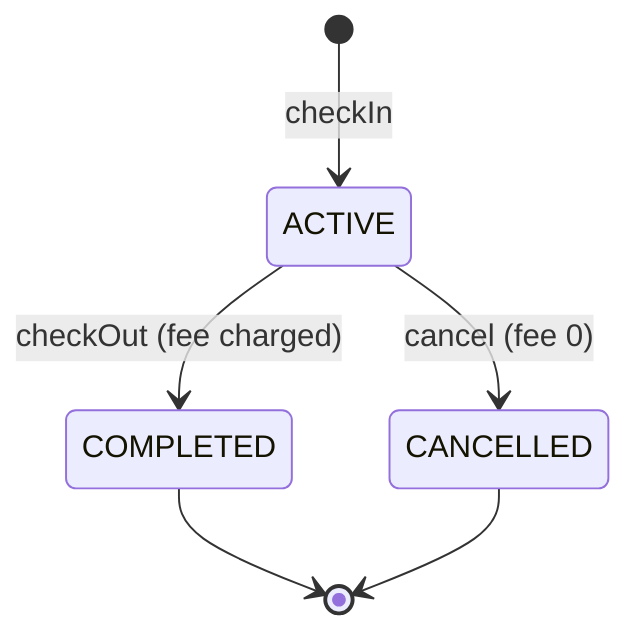
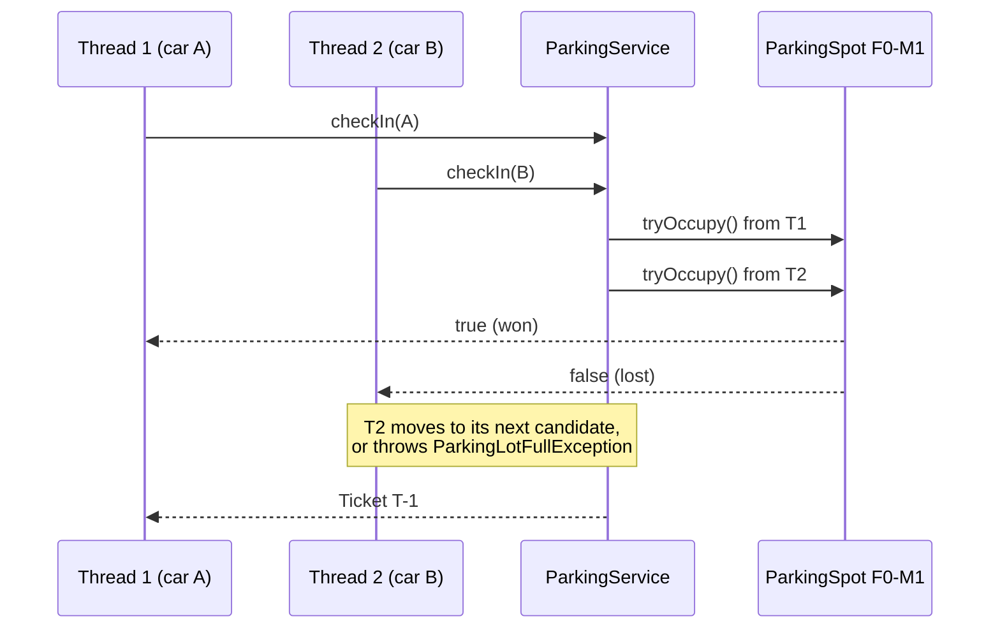
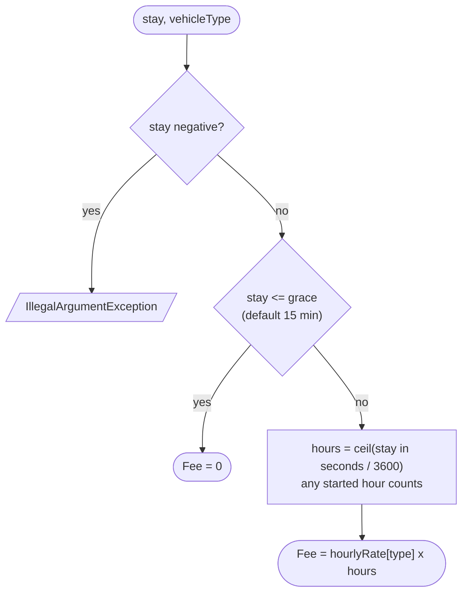
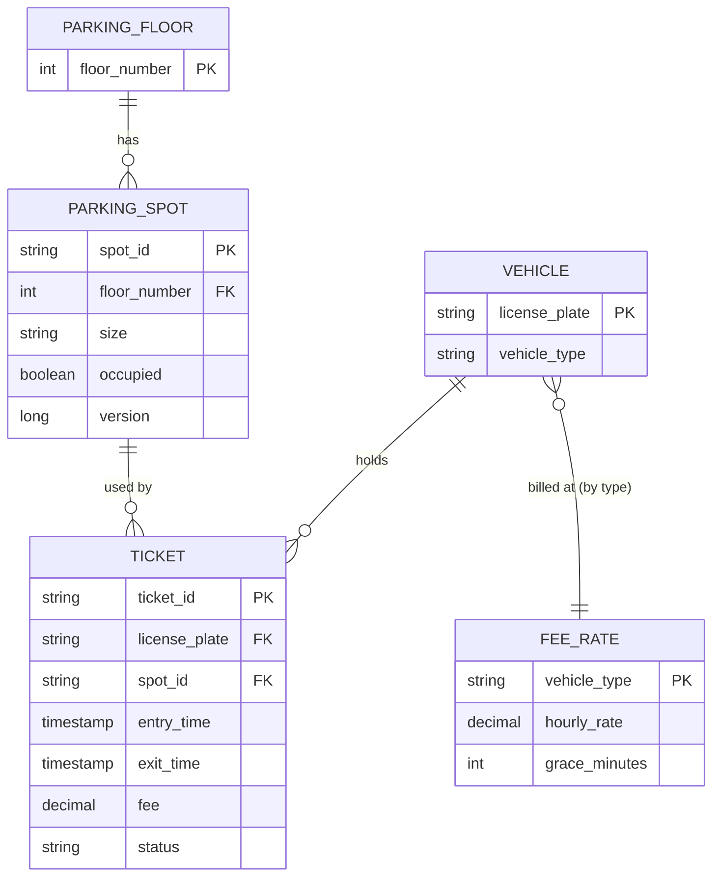

# Flows and diagrams

Mermaid diagrams for the parking lot. GitHub and IntelliJ (Markdown plugin) render them.

## 1. Class overview

## 2. Check-in

If the compute block throws, nothing is stored for that plate, so a failed entry leaves no phantom "already parked" record.

## 3. Check-out

Cancel is the same flow without the fee step: `ticket.cancel(now)` sets status `CANCELLED` and fee 0, then the spot is released.

## 4. Ticket lifecycle

Any other transition throws `InvalidTicketStateException`.

## 5. Two cars racing for the last spot

## 6. Fee calculation

Default rates per hour: motorcycle 10, car 20, bus 50.

| Stay (car) | Fee |
|---|---|
| 15 min | 0 |
| 15 min 1 s | 20 |
| 1 h | 20 |
| 1 h 1 s | 40 |

## 7. Spot allocation orders

Both strategies filter to free spots that fit the vehicle, then sort.

| Strategy | Sort order | Why |
|---|---|---|
| `BestFitStrategy` | size, then floor, then id | keeps large spots free for buses |
| `NearestFloorFirstStrategy` | floor, then size, then id | shortest walk to the exit |

A vehicle fits any spot at least as big as its minimum size: motorcycle takes small, medium or large; car takes medium or large; bus takes large only.

## 8. Data model

Partial unique indexes on `ticket` allow only one `ACTIVE` ticket per plate and per spot. See `src/main/resources/schema.sql`.
